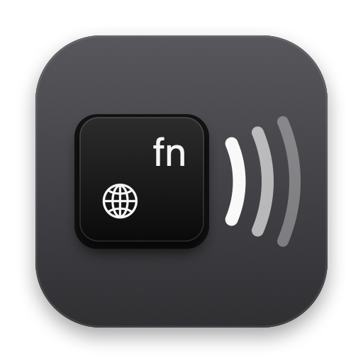
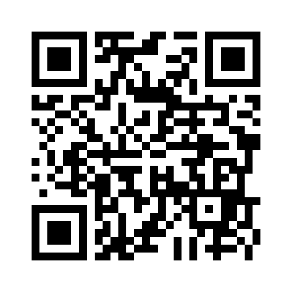

<p align="center">
  
</p>

<h1 align="center">Clackey</h1>

<p align="center">
  Mechanical keyboard sounds for your MacBook.<br>
  <a href="https://aakocval.github.io/clackey/"><b>Try it in your browser</b></a> ·
  <a href="https://github.com/aakocval/clackey/releases/latest/download/Clackey.dmg"><b>Download</b></a>
</p>

---

Clackey lives in your menu bar and plays a real mechanical switch sound every time you type or click.
Typing feels more tactile and satisfying, which makes it easier to get into a focused flow.

- Two recorded switches: **Gateron Red** and **Cherry MX Red**
- Mouse and trackpad click sounds
- Spatial audio, tone control and volume
- Free, open source, and no network access

Requires macOS 13 or later.

More sound packs are coming in future releases. Want a particular switch?
[Open an issue](https://github.com/aakocval/clackey/issues).

## Install

1. [Download **Clackey.dmg**](https://github.com/aakocval/clackey/releases/latest/download/Clackey.dmg) and open it.
2. Drag **Clackey** onto **Applications**.
3. Open Clackey. The first time, macOS blocks it because it isn't from the App Store.
   Go to **System Settings › Privacy & Security** and click **Open Anyway**.
4. When asked, turn on Clackey under **Input Monitoring**.

An **fn** key icon appears in your menu bar. Start typing.

> **See ⚠︎ in the menu bar?** Input Monitoring is off. Turn it on in System Settings, then reopen Clackey.

## Privacy

Clackey only reads which key was pressed, so it can choose a sound. It doesn't record, store or send
anything, and it runs in Apple's App Sandbox with no network access. Password fields stay silent.
See [SECURITY.md](SECURITY.md).

## Custom sounds

Menu › **Sound Pack** › **Open Packs Folder**, then add a folder of short `.wav` files:

```
My Board/
  down-1.wav  down-2.wav …   key presses (required)
  up-1.wav    up-2.wav …     key releases
  space.wav                  spacebar
```

To make a pack from a recording of yourself typing:

```bash
python3 scripts/slice_recording.py my-typing.wav "My Board"
```

## Build from source

```bash
git clone https://github.com/aakocval/clackey.git
cd clackey
scripts/build_app.sh && open build/Clackey.app
```

To build the release DMG and zip, use `UNIVERSAL=1 scripts/build_app.sh release`.

To run the browser demo locally, use `scripts/build_site.sh serve`.

## Share



**[aakocval.github.io/clackey](https://aakocval.github.io/clackey/)**: scan or send this link to try Clackey in the browser and download it.

## Credits

Sounds are CC0 recordings from [Freesound](https://freesound.org):
[Gateron Red](https://freesound.org/people/SamsterBirdies/sounds/489422/) by SamsterBirdies,
[Cherry MX Red](https://freesound.org/people/handygaber/sounds/499773/) by handygaber,
[mouse clicks](https://freesound.org/people/Soundscape_Leuphana/sounds/210309/) by Soundscape_Leuphana.

MIT License
